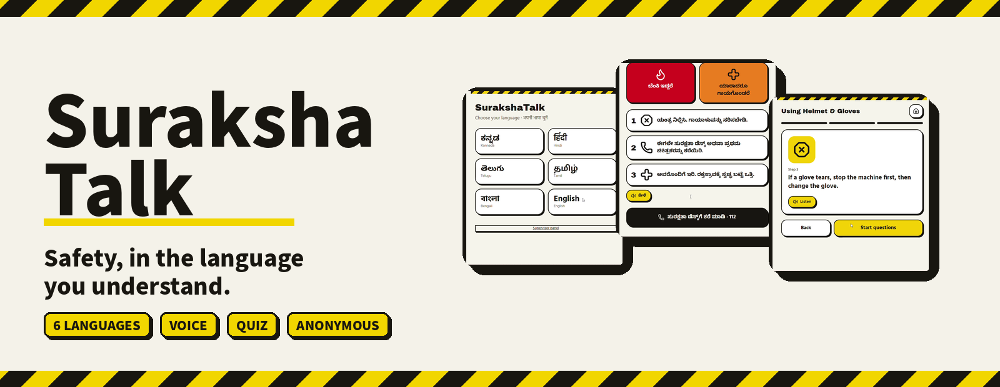
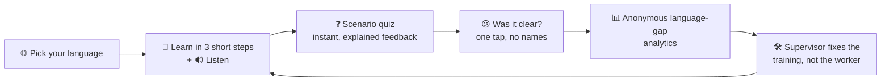
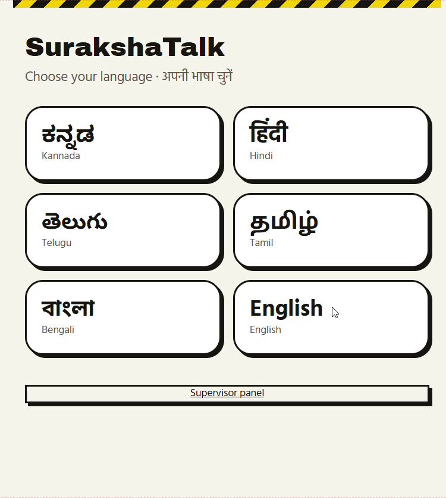
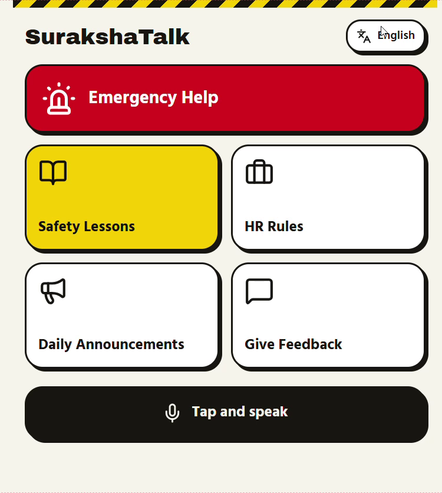
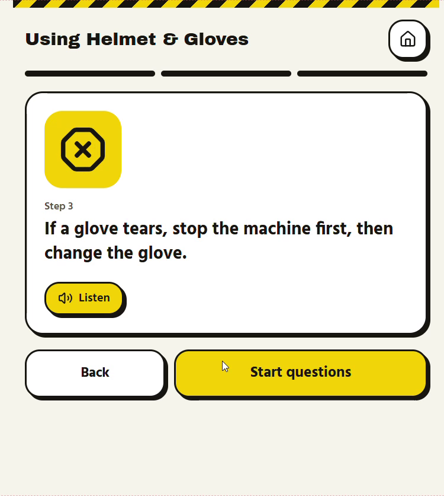
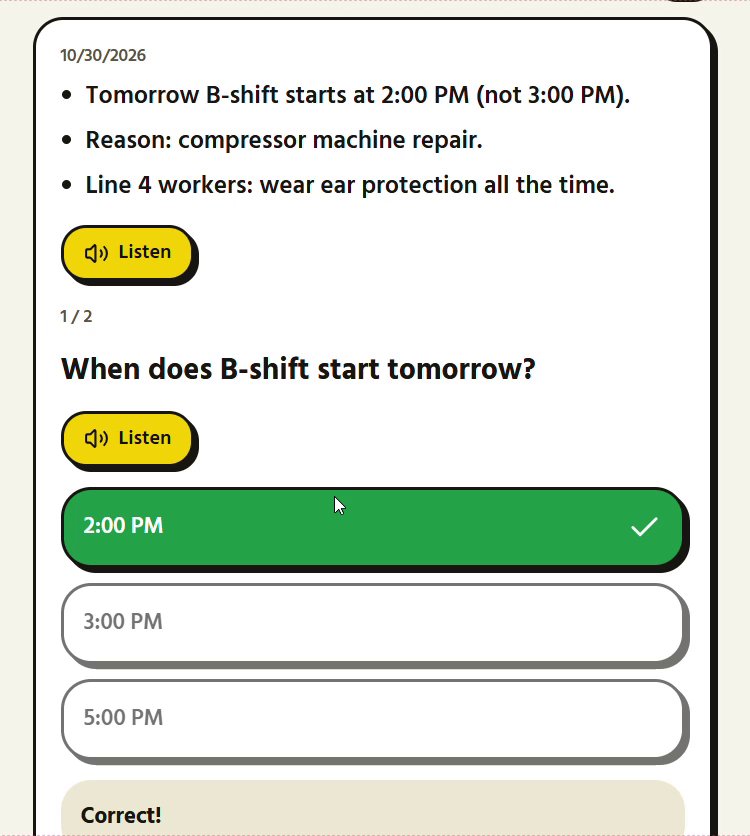
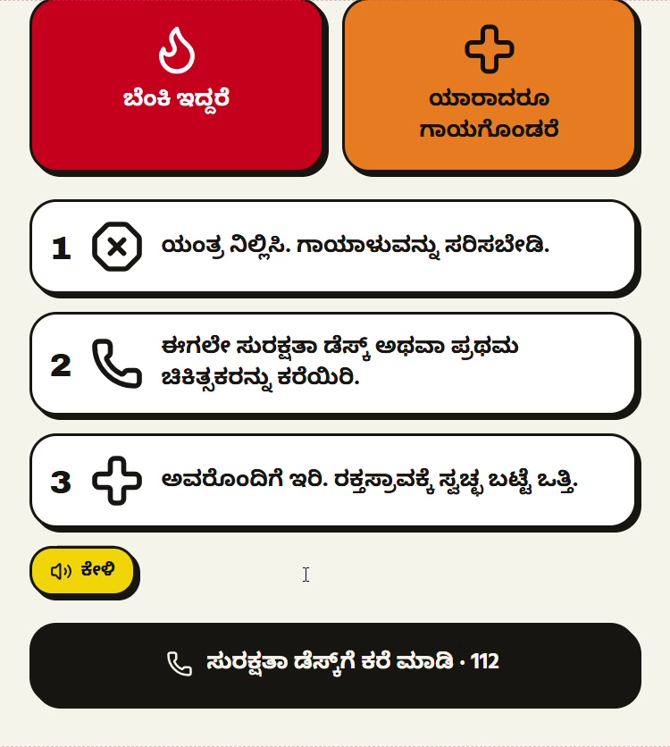
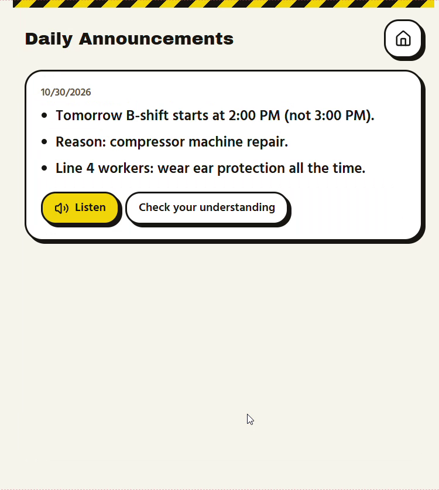
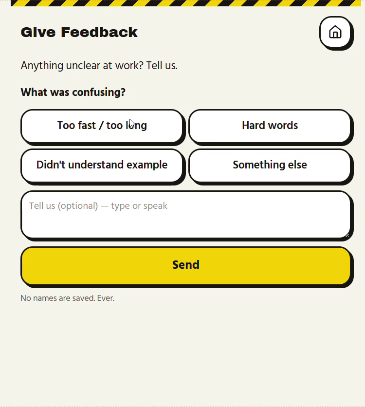
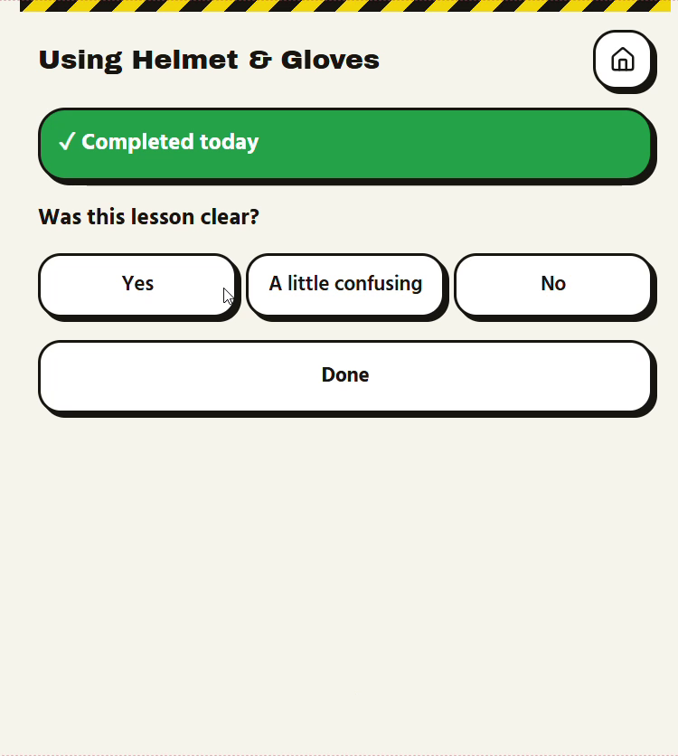

<p align="center">
  
</p>

<p align="center">
  
  
  
  
</p>

<h3 align="center">"Do you understand?" &nbsp;→&nbsp; "Yes." &nbsp;→&nbsp; <i>Nobody checked.</i></h3>

<p align="center">
  <b><a href="YOUR_LIVE_DEMO_LINK">▶ Live demo</a></b> &nbsp;·&nbsp;
  <b><a href="YOUR_DEMO_VIDEO_LINK">🎥 Demo video</a></b> &nbsp;·&nbsp;
  <b><a href="#-screens">📱 Screens</a></b>
</p>

---

## 🧨 The problem: the nod

In a factory, a supervisor reads out the safety rules in one language, asks *"Understood?"*, and every worker nods. Migrant workers who speak Kannada, Hindi, Telugu, Tamil or Bengali nod too, because saying *"I didn't understand"* feels risky.

The form gets signed. The training is "done". The risk is still there.

> Safety communication is treated as a **one-way compliance task**, so understanding is *assumed* instead of *verified*, and management never learns which language, topic or word is failing.

## 🦺 Our answer: teach → check → listen → measure

**SurakshaTalk** is a phone-first safety companion that explains the rules in the worker's own language, with big icons and audio. It then **asks a short question to prove the message landed**, and turns every wrong answer into anonymous data a supervisor can act on.



## 📱 Screens

<table>
  <tr>
    <td align="center"><br><b>Pick a language</b><br><sub>Native scripts, no login</sub></td>
    <td align="center"><br><b>Everything in 1 tap</b><br><sub>Big tiles + "Tap and speak"</sub></td>
    <td align="center"><br><b>3-step lessons</b><br><sub>Icon, one sentence, 🔊 Listen</sub></td>
    <td align="center"><br><b>Teach-and-check quiz</b><br><sub>Instant "why" feedback</sub></td>
  </tr>
  <tr>
    <td align="center"><br><b>Emergency, in Kannada</b><br><sub>Fire / injured, one-tap call</sub></td>
    <td align="center"><br><b>Daily announcements</b><br><sub>Short bullets + audio</sub></td>
    <td align="center"><br><b>Safe to say "I'm lost"</b><br><sub>"No names are saved. Ever."</sub></td>
    <td align="center"><br><b>Clarity check</b><br><sub>Yes / A little confusing / No</sub></td>
  </tr>
</table>

## ✨ What's inside

| | Feature | What it does |
|---|---|---|
| 🌐 | **Multilingual UI** | Kannada, Hindi, Telugu, Tamil, Bengali and English. The *whole interface* switches, not just the lessons. |
| 📘 | **Lessons** | Helmet & Gloves · Working with Machines (lockout/tagout) · Fire and Smoke · Attendance & Leave · Reporting Harassment |
| 🔊 | **Listen on everything** | Every step, question and announcement can be read aloud, for workers who read slowly or not at all. |
| ❓ | **Understanding checks** | Two short scenario questions per lesson. A wrong answer shows *why*, in simple words. |
| 😕 | **Clarity feedback** | One tap after each lesson, plus a free "what was confusing?" form (too fast · hard words · no example) with typing or a mic. |
| 📢 | **Daily announcements** | Long notices become 2–4 plain bullets with audio and a one-question check ("What time does B-shift start?"). |
| 🚨 | **Emergency Help** | Red/orange big buttons for **FIRE** and **INJURED**, three icon steps each, and a one-tap *Call Safety Desk*. |
| 📊 | **Supervisor panel** | Anonymous, aggregated view of where each language and topic is failing. |

## 🎨 Designed for a noisy shop floor

The look borrows from the place it will be used: **hazard stripes, thick outlines, huge tap targets.**

- 🟨 **Yellow** = do this next 🟥 **Red** = emergency 🟩 **Green** = you got it
- One idea per screen. Icons carry the meaning, text confirms it.
- Works on a low-end phone or a shared tablet at the factory gate.

## 🔒 Privacy by design

- **No accounts, no names, no biometrics.** Answers are tied only to a random session.
- Supervisors see **aggregates** (language × topic × question), never individuals.
- The point is to measure *the training*, not to monitor *the worker*.

## 🚀 Run it locally

```bash
git clone YOUR_REPO_URL
cd YOUR_REPO_NAME
npm install
npm run dev
```

Then open the local URL on your phone or in a mobile-sized browser window.

## 🧭 Honest limits (hackathon prototype)

- **Translations are AI-assisted and not yet verified by native speakers.** For safety content this must happen before any real deployment.
- **Audio uses the device's built-in voices**, and not every phone has a voice for every language. The app should degrade gracefully, but test on your device.
- Lessons and emergency steps are **generic demo content**. Real procedures differ by factory.
- Analytics shown in the demo may include **clearly-labelled sample data**.

## 🗺 What's next

- [ ] Native-speaker review of every translated string
- [ ] Reliable speech-to-text for spoken answers and voice feedback
- [ ] Offline mode for plants with weak connectivity
- [ ] Supervisor-authored lessons and quizzes
- [ ] Pilot on a real shop floor, and compare quiz scores over weeks

## 👥 Team

**YOUR TEAM NAME** · built for the **TCS iON AI Hackathon**

| Name | Role |
|---|---|
| YOUR NAME | e.g. Product & Build |
| TEAMMATE | e.g. Content & Testing |

---

<p align="center"><b>Safety isn't safe until it's understood.</b> 🦺</p>
